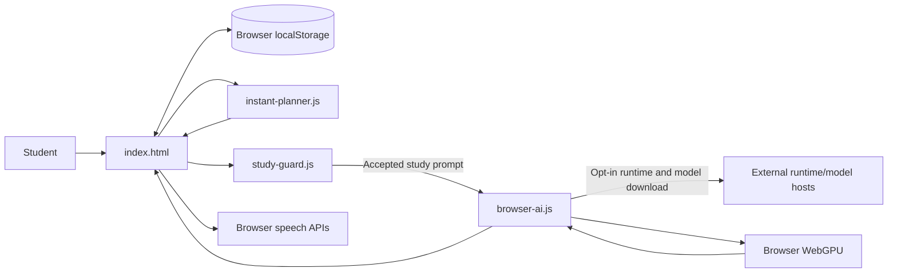

# Architecture

This document describes the static browser edition of Study Buddy. The design is intentionally small: the browser serves as the UI, local state store, scheduling runtime, speech interface, and — only when requested — AI inference host.

## Design goals

- Keep planning available without downloading or running a language model.
- Keep user planning data in the current browser rather than introducing a cloud account/database.
- Make optional AI loading explicit so a large model is not downloaded on page load.
- Keep the project deployable as static files with no build pipeline or paid inference key.
- Make study-scope checks and their limitations visible to maintainers.

## High-level data flow

The hosting provider serves files but does not process planner requests. No application backend is included in this edition.

## Main modules

| File | Responsibility | Notes |
| --- | --- | --- |
| `index.html` | UI, page navigation, saved state, planner interactions, progress, voice controls, and tutor entry points. | Most presentation and event wiring lives here today. |
| `instant-planner.js` | Deterministic schedule generator. | No network calls and no model dependency. Exposed as `SBInstantPlanner`. |
| `study-engine.js` | Lightweight topic recommendation helper based on confidence, exam date, and recency. | Exposed as `SBStudyEngine`; separate from language-model inference. |
| `study-guard.js` | Academic subject validation and prompt-scope heuristics. | Exposes `SBStudyGuard`; intentionally dependency-free. |
| `browser-ai.js` | Loads WebLLM on user request, initializes a selected SmolLM2 model, streams tutor output, and handles fallbacks/errors. | Uses WebGPU and external downloads. |
| `model-picker.js` | Legacy model-picker compatibility. | Kept while the current UI and tutor adapter share interfaces. |
| `shim.js` | Compatibility layer for the existing tutor interface. | Avoids rewriting the whole notebook around a new client API. |
| `preview-server.cjs` | Serves the project over local HTTP for development. | Uses Node built-ins; no npm dependencies are required. |
| `vercel.json` | Declares static deployment behavior and response headers. | No serverless function or environment variable is needed. |

## State and persistence

The UI serializes planner state into `localStorage` in the current browser profile. This allows the same browser to restore a plan after a refresh, but it is not a backup service: clearing site data, using a private window, or switching devices can make the saved state unavailable.

The planner module itself is mostly functional: it accepts exam data, a daily time budget, and an optional current timestamp; it returns a plan, stats, warnings, or a validation error. The UI is responsible for storing that result and rendering tasks.

## Optional tutor lifecycle

1. The visitor explicitly presses **Load AI tutor**.
2. `browser-ai.js` checks secure-context and WebGPU support.
3. It dynamically imports WebLLM version `0.2.82` from `esm.run`.
4. WebLLM downloads/initializes the selected model. The lightweight SmolLM2 360M option is the default.
5. Tutor prompts pass through the UI's study-scope guard before generation.
6. Generation streams text where supported. If streaming fails before emitting any text, the adapter attempts a non-streaming completion.
7. GPU device-loss errors stop automatic retries and ask the user to restart the browser.

The tutor is experimental. Runtime compatibility, model quality, download availability, memory use, and generated answers vary by device and browser.

## Speech behavior

The app uses browser speech synthesis to read scheduled tasks. Voice commands use `SpeechRecognition` or `webkitSpeechRecognition` when a browser exposes either implementation. Neither API is guaranteed to exist on every browser. Typed input remains available where speech recognition is unsupported.

## Security boundaries

- Static deployment means there is no server-side user database or server API to protect in this edition.
- The study guard is a product-scope heuristic, not an authorization or security boundary.
- The browser downloads optional runtime/model assets from third parties; those requests disclose ordinary network metadata.
- `vercel.json` adds baseline response headers, but this project has not undergone a formal security audit.
- Never commit credentials, tokens, `.env` files, or private study records.

## Why no framework build step?

The current application is a plain static site with a small number of JavaScript modules. Avoiding a bundler keeps setup simple and makes the deployment path easy to inspect. If the app grows substantially, a module split and a dedicated component/test architecture can be considered as a separate design change.
